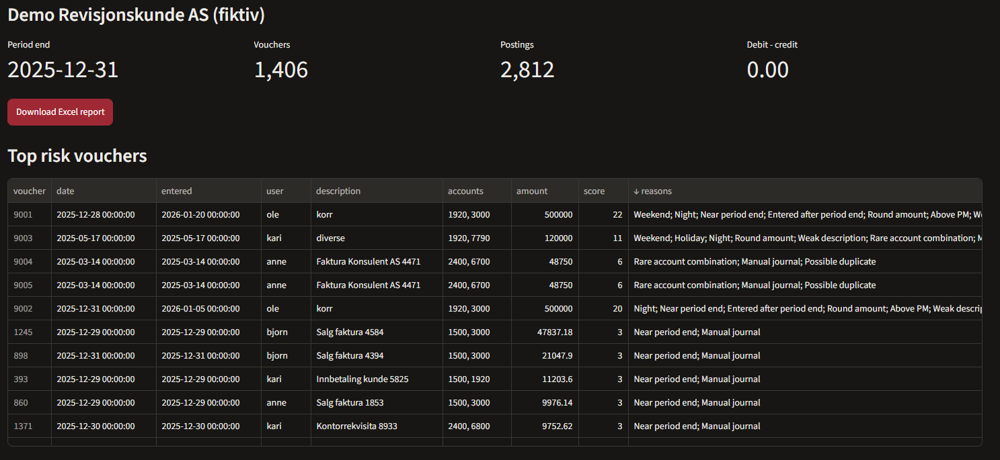
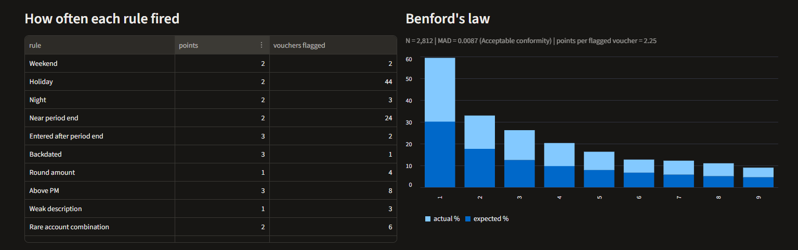
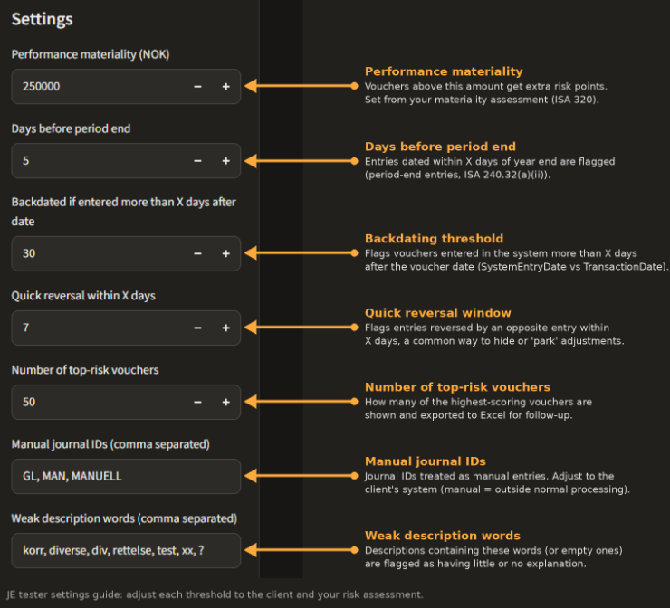
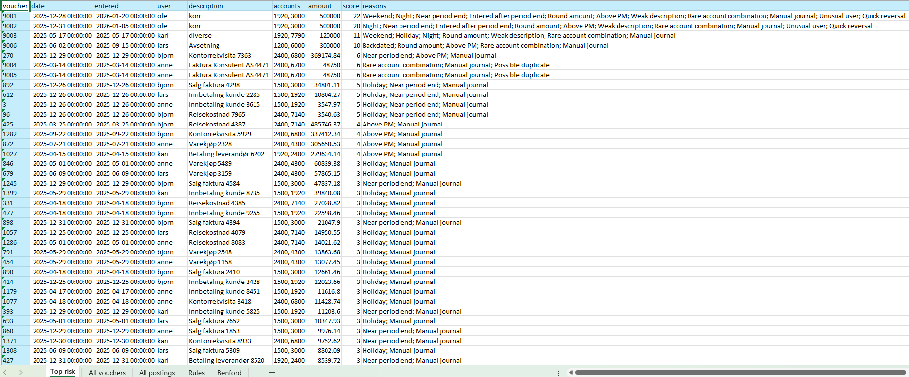

# Journal Entry Tester – SAF-T & ISA 240

**Live demo:** [journalentrytestersaftisa240.streamlit.app]  
*Demo only – uses a fictional data set. Do not upload real client data.*

A tool that reads a Norwegian SAF-T Financial file and ranks every voucher by fraud risk, using the risk characteristics described in ISA 240. The auditor gets a prioritised list of the entries most worth testing, with the reason each one was flagged, in under a minute.

## Why this matters for auditors

ISA 240 presumes a risk of management override of controls in every audit and requires the auditor to test the appropriateness of journal entries. In practice this often means:

- filtering the general ledger by hand in Excel, one criterion at a time
- repeating the same filters for every client and every year
- spending time on low-risk entries because selection is not risk-ranked
- documenting afterwards why particular entries were chosen

This tool turns that work into one repeatable step:

| Manual approach | With this tool |
|---|---|
| One filter at a time | 15 risk tests run together on 100% of entries |
| Separate lists per criterion | One combined risk score per voucher |
| Selection rationale written up afterwards | Reason for every flag stated in the report |
| Rebuilt for each client | Same file format (SAF-T) for every Norwegian client |

**Day-to-day benefits**
- **Faster planning and fieldwork:** the high-risk population is identified at the start of the engagement, not after hours of filtering.
- **Better focus:** entries that combine several risk factors (e.g. a round, manual revenue posting made after year end by a rarely used user) rise to the top.
- **Full population coverage:** every entry is tested, not just a sample.
- **Clearer documentation:** the Excel report can support the working paper by showing which criteria were applied and why each entry was selected.
- **Consistency:** the same criteria are applied across clients and team members, with thresholds adjusted per engagement.

## What it tests

| Area | Tests |
|---|---|
| Timing | Weekends, Norwegian public holidays, night-time entries, near period end, entered after period end, backdated entries |
| Amount | Round amounts, amounts above performance materiality |
| Description | Missing or vague descriptions ("korr", "diverse") |
| Behaviour | Rare account combinations, users who rarely post, quick reversals, possible duplicates |
| Statistics | Benford's law (first digit) with z-tests and MAD conformity |

Each test adds points to a voucher's risk score. The Benford test is weighted by population size, because the analysis is unreliable on small data sets: it gives no points at 500 entries or fewer and full points from 5,000 entries.

## How to use it

1. Set engagement-specific thresholds in the sidebar (performance materiality, period-end window, manual journal codes etc.).

2. Upload a SAF-T Financial XML file, or tick the box to use the demo file (only use the demo file. Never upload real customer data to this *demo*).
3. Review the top-risk list, rule statistics and Benford chart on screen.
4. Download the Excel report (top risk, all vouchers, all postings, rule summary, Benford analysis).

## Validation

The tool was tested on a fictional SAF-T file with about 1,400 normal vouchers and six planted high-risk entries (a period-end revenue correction and its reversal, a holiday night posting, a backdated provision and a duplicate invoice). The planted revenue correction and reversal, the holiday night posting and the backdated provision ranked at the top of the list, and the duplicate invoice was flagged as a possible duplicate.

## Limitations

- A high score means "look at this first", not "this is fraud". Professional judgement is still needed to select and test entries.
- Thresholds and manual journal codes must be adapted to each client's systems and the auditor's risk assessment.
- Built for SAF-T Financial version 1.30 (Norway).
- This is a student project and not a replacement for a firm's approved audit tools.

## Built with

Python · pandas · Streamlit · openpyxl

## Run locally

    pip install -r requirements.txt
    streamlit run app.py 